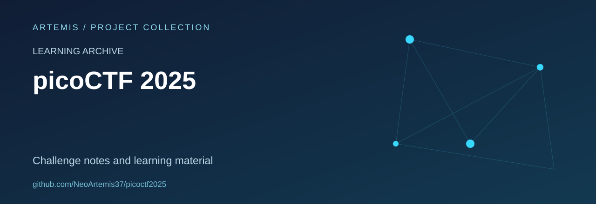

# picoCTF 2025 Learning Archive

Challenge notes and supporting artefacts retained from picoCTF practice.

**Status:** personal learning archive. Some files are notes, others are challenge binaries, captures or exploratory analysis scripts.

## Explore

The [`pico/`](pico/) directory contains the material. Examples of included note files are [`apriti-sesamo.md`](pico/apriti-sesamo.md) and [`bitlocker1.md`](pico/bitlocker1.md).

The archive spans different challenge topics, including program analysis, cryptography and network captures. There is no claim that every file has a complete write-up or a verified result.

## Documentation priorities

- Add a challenge index with category and completion state.
- Distinguish original challenge files from personal analysis.
- Record the source of each artefact and the environment used for study.
- Describe lessons learned and defensive implications in the relevant notes.

## Related learning

The broader [Labs and CTF Notes](https://github.com/NeoArtemis37/Labs_Ctfs_Writeups) repository provides a separate index for other platforms and events. Different event archives are not interchangeable duplicates merely because both contain CTF material.

## Attribution and reuse

picoCTF challenge names and supplied materials retain their original author attribution and terms. This repository is not an official picoCTF distribution or a client-assessment portfolio.

No repository-wide licence file is currently included.
